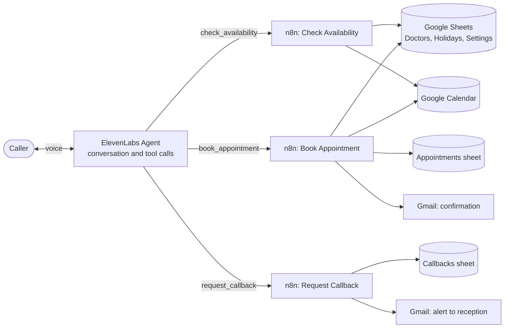

# AI Hospital Receptionist

**A voice AI that answers the phone, finds an open slot, books the appointment, and emails the confirmation. No human touches a calendar.**

    

A demo project for a fictional hospital (**City Care Hospital**, fictional doctors, fake patient data only). It shows how a voice agent can run a real workflow end to end: understanding a caller, checking real availability, booking safely, and handling emergencies and out-of-scope requests.

## Demo

- LinkedIn write-up & Video: https://www.linkedin.com/feed/update/urn:li:activity:7522353009175969794/)

<!-- After you add screenshots to docs/images/, remove these comment markers:


-->

## What it does

- Understands the **doctor or department** the caller wants and finds real open slots, or the **earliest openings** when the caller has no day in mind
- Collects the details in **two short turns**, reads everything back **once**, and books only after a clear "yes"
- Creates the **Google Calendar** event, logs the booking in **Google Sheets**, and sends a **Gmail** confirmation
- Rejects unknown doctors and departments, past dates, holidays, double bookings, duplicate bookings, and bad phone numbers
- Recognizes **emergencies** and sends the caller to 1122 instead of booking
- Gives **no medical advice** and takes a **callback request** when it cannot help
- English first, with Urdu configured (see limitations)

### Example conversation

> **Agent:** Thank you for calling City Care Hospital. I'm an AI assistant. How can I help you today?
> **Caller:** I need a cardiologist.
> **Agent:** One moment while I check. The earliest openings are with Dr. Sana Malik, Cardiology, on Tuesday at ten, ten twenty, or ten forty. Does one of those work?
> **Caller:** The first one, please.
> **Agent:** Could I have your full name and phone number? An email is optional if you would like a confirmation.
> **Caller:** (gives name, phone, and email)
> **Agent:** Have you visited before, and what is the visit for?
> **Caller:** First visit, a general consultation.
> **Agent:** *(reads the doctor, date, time, name, phone, and email back once)* Shall I book it?
> **Caller:** Yes.
> **Agent:** Your appointment is booked. A confirmation with your appointment ID has been emailed to you.

## How it works



**The AI talks. Code decides.** ElevenLabs runs the conversation. The three n8n workflows do the exact work with plain logic: working hours, holidays, lead time, double-booking and duplicate checks. There is no language model inside n8n, so slot results are the same every time and can be tested. The slot is checked once when offered and **again at the moment of booking**.

| Tool | Webhook | Purpose |
|---|---|---|
| `check_availability` | `POST /check-availability` | Validates the doctor or department first, then returns open slots, the earliest openings, or a clear reason |
| `book_appointment` | `POST /book-appointment` | Re-checks the slot, creates the calendar event, logs the row, answers, then emails the patient |
| `request_callback` | `POST /request-callback` | Logs the request and alerts reception |

More detail: [architecture](docs/architecture.md) · [tool API](docs/tool-api.md) · [design decisions](docs/design-decisions.md)

## Tech stack

| Layer | Tool |
|---|---|
| Voice and conversation | ElevenLabs Agents |
| Backend logic | n8n (3 workflows, 32 nodes) |
| Source of truth for bookings | Google Calendar |
| Rules and records | Google Sheets |
| Notifications | Gmail |
| Tests | Node.js (offline), Python and `requests` (live) |

## Testing

Voice minutes are expensive, so problems are found in the cheapest layer first:

```bash
node tests/logic/harness.js      # 50 offline logic checks, no setup
python tests/test_tools.py       # 23 live tests against your n8n workflows
```

The tests cover double bookings, duplicate bookings, past dates, holidays, unknown doctors and departments, short phone numbers, invalid slot times, and callback validation. See [testing](docs/testing.md).

## Repository structure

```
.
├── agent/            system prompt and ElevenLabs configuration
├── data/             Google Sheet template (fictional data)
├── docs/             architecture, tool API, design decisions, setup, testing
├── src/code-nodes/   readable copies of the n8n Code node logic
├── tests/            offline logic checks and live integration tests
└── workflows/        the three n8n workflows (credentials removed)
```

## Quick start

1. Import `data/city-care-hospital-sheet-template.xlsx` into Google Sheets and create a calendar named `Hospital Appointments`.
2. Import the three files in `workflows/` into n8n, connect your Google accounts, and activate them.
3. Run the tests until they pass.
4. Create the agent in ElevenLabs from `agent/agent-config.md` and `agent/system-prompt.txt`.

The full walkthrough is in [docs/setup-guide.md](docs/setup-guide.md).

## Safety and privacy

- The emergency response overrides every other behavior and uses a fixed number (1122 in the demo; verify it for your region).
- The agent never gives medical advice and never asks for or stores symptoms; the visit is a short category such as "general consultation".
- It never shares other patients' information and refuses attempts to override its rules.
- The demo uses fictional data only. This is a portfolio project, **not a medical device**.

## Known limitations

- **No locking:** two callers booking the same slot at the same instant could both succeed. Fine for one clinic; a database or queue would fix it.
- **Speed:** each tool call takes about 4 to 5 seconds because several Google Sheets are read one after another.
- **Duplicated rules:** the check and book workflows both apply the slot rules. A shared sub-workflow or a small backend would remove the duplication.
- **Urdu:** configured and logic-tested (numerals), but voice quality is not yet validated end to end.
- **Production use:** a real hospital needs a paid ElevenLabs plan in its own account (the free plan has no commercial license) and a privacy and compliance review.

## Roadmap

- [ ] Cancel and reschedule with identity checks (appointment ID plus phone)
- [ ] Hospital information answers (timings, location, visiting hours)
- [ ] SMS and WhatsApp confirmations and reminders
- [ ] Faster tools (merged reads or a small backend service)
- [ ] A real phone number
- [ ] Post-call summaries and a management dashboard
- [ ] Urdu voice validation

## Author

Built by **Ansar Hayat**, AI automation engineer. GitHub: [@ansarhayat9](https://github.com/ansarhayat9) · LinkedIn: (https://www.linkedin.com/in/ansar-hayat-b7a50a293/)

If your clinic loses bookings to missed calls and you would like something like this, get in touch.

## License

[MIT](LICENSE)
