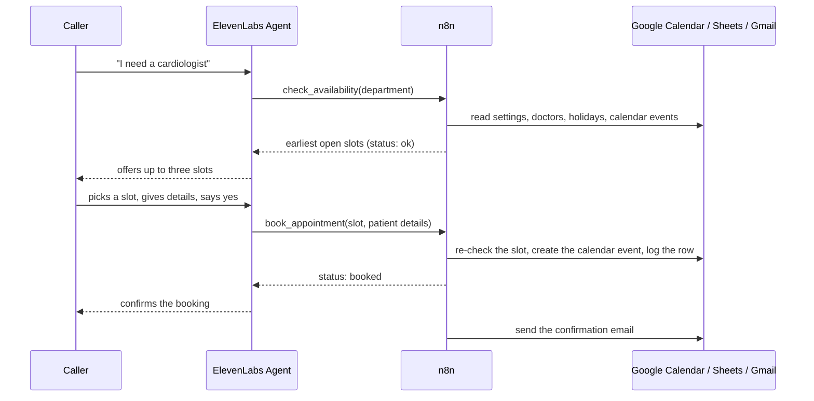

# Architecture

## Components

| Component | Responsibility |
|---|---|
| **ElevenLabs Agent** | Holds the phone conversation, understands speech, decides when to call a tool, and speaks the result. The only place a language model runs during a call. |
| **n8n webhooks (3 workflows)** | Receive tool calls, validate input, apply the hospital rules, and return clean JSON with a `status` and a `message`. |
| **Google Calendar** | Source of truth for what is booked (calendar `Hospital Appointments`). |
| **Google Sheets** | Hospital rules and records: doctors, holidays, settings, appointment log, callback list. |
| **Gmail** | Patient confirmation emails and reception callback alerts. |

## Call flow

## The three workflows

| Workflow | Webhook path | Nodes | What it does |
|---|---|---|---|
| 1. Check availability | `POST /check-availability` | 8 | Prepare Request, read Settings, Doctors, Holidays, and Calendar events, then Find Slots returns open slots or a clear reason why not. |
| 2. Book appointment | `POST /book-appointment` | 15 | Validates, re-checks the slot against the calendar, creates the event, logs the row, responds, then emails the patient. |
| 3. Request callback | `POST /request-callback` | 9 | Validates, logs the request, responds, then alerts reception. |

Implementation notes that matter when you edit the workflows:

- **Execute Once** is switched on for the sheet and calendar read nodes that follow another read. Without it, a node would run once per row of the previous node.
- **Always Output Data** is switched on for nodes that can legitimately return nothing (an empty Holidays tab, a day with no calendar events). Without it, the workflow would stop silently.
- The booking workflow sends its answer (**Respond Booked**) *before* the confirmation email, so the caller never waits for Gmail.
- All rule logic lives in Code nodes (readable copies in [`src/code-nodes`](../src/code-nodes)). There is no language model inside n8n.

## Data model

**Google Calendar event** (created by the booking workflow)

- Title: `<Doctor name> - <Patient name>`
- Description lines: `appointment_id`, `doctor_id`, `phone`, `patient_type`, `visit`, `booked_by`
- A slot counts as busy for a doctor when an event overlaps it and its title contains the doctor's name or its description contains `doctor_id: <id>`. A manual event such as `Dr. Sana Malik - Leave` therefore blocks that doctor.

**Google Sheets tabs** (see `data/city-care-hospital-sheet-template.xlsx`)

| Tab | Columns |
|---|---|
| Doctors | doctor_id, name, department, working_days, start_time, end_time, slot_minutes |
| Appointments | appointment_id, created_at, patient_name, phone, email, patient_type, visit_category, doctor_id, doctor_name, department, date, start, end, calendar_event_id, status, source |
| Callbacks | callback_id, created_at, patient_name, phone, reason, status, handled_by |
| Holidays | date, description |
| Settings | key, value (hospital_name, timezone, min_lead_minutes, max_advance_days, slots_offered, emergency_number, reception_email) |

All cells are plain text so phone numbers keep their leading zero and times stay as `09:00`.

## Business rules (as implemented)

- Time zone is fixed to Asia/Karachi (UTC+5, no daylight saving).
- Slots are generated per doctor from `working_days`, `start_time`, `end_time`, and `slot_minutes`.
- Nothing is offered or booked in the past, closer than `min_lead_minutes` (default 120), or beyond `max_advance_days` (default 30).
- Holidays listed in the Holidays tab are closed for everyone.
- Up to `slots_offered` (default 3) slots are returned. If the requested part of the day is full, other times that day are offered; if the day is full, the next day with openings (within the next two weeks) is returned.
- With no date, the earliest openings from today are returned.
- The same phone number cannot hold two appointments with the same doctor on the same day.
- Appointment IDs look like `APT-20261027-314`: the date plus a random three-digit number that is unique among that day's events.
- Phone numbers are reduced to digits (Urdu and Arabic numerals are converted) and must have 10 to 13 digits. Names are stripped of control characters and angle brackets. An invalid email is ignored and the booking still succeeds.
